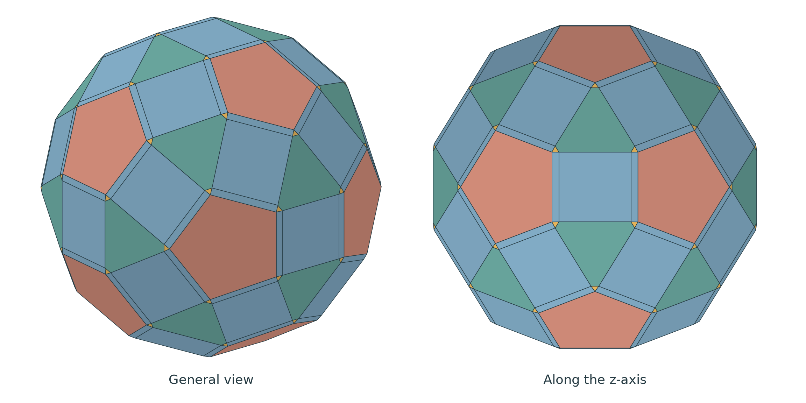

# Phinopert

An explicit **180-vertex non-Rupert polyhedron** with icosahedral symmetry.



Phinopert is a centrally symmetric convex polyhedron constructed from two
icosahedral orbits. This project provides its exact coordinates, a printable
model, the research manuscript, and supporting Lean developments.

**Proof status — 18 October 2026:** the recorded Python exact-arithmetic
certificate chain covers all 432 original regions. The complete non-Rupertness
theorem is **not yet proved in Lean**. The full historical certificate archive
is not included in this repository snapshot; see [reproduction](docs/REPRODUCING.md).

## What is Rupert’s property?

A solid is Rupert if a congruent copy can pass straight through a suitably
oriented tunnel in it with positive clearance. For convex solids, this is
equivalent to placing one orthogonal projection strictly inside another,
allowing planar translation. Coincident or merely touching shadows do not count.

Phinopert is not the first non-Rupert polyhedron, nor a smallest-vertex example.
The contribution is this particular orbit-hull and its body-specific contact
and coverage certificates, using established exact-inequality methods.

## The solid

Let `φ = (1 + sqrt(5))/2`, and let `I` be the proper icosahedral rotation group
preserving the signed cyclic permutations of `(0, φ, 1)`. Here `sqrt(5)` is
the positive square root of five, and `conv` denotes the convex hull. Define

```text
K(a,b) = conv{ ±g(2 + φ + a, b, φ²) : g ∈ I }

H = conv( K(-1/4, 0) ∪ (19/20) K(0, 1/10) )
```

The factor `19/20` uniformly scales the second body before taking the convex hull.

The generating orbits contain 60 and 120 points. Every one is an exposed vertex,
with coordinates that are rational combinations of `1` and `sqrt(5)`. The historical identifier is
`ico_union_0`; **Phinopert** is this project's chosen name.

## Start here

| Material | Location |
| --- | --- |
| Paper source, including its figure | [paper/phinopert.tex](paper/phinopert.tex) |
| Exact shape record and geometric witnesses | [geometry/](geometry/) |
| Printable 100 mm STL | [models/phinopert-100mm.stl](models/phinopert-100mm.stl) |
| Lean source snapshot and dependency notes | [lean/](lean/) |
| What has been checked, and what remains | [Proof status](docs/PROOF_STATUS.md) |
| Reproduction and trust boundaries | [Reproducing the results](docs/REPRODUCING.md) |

### Small checks

From the repository root, using Python 3.10 or later and its standard library:

```bash
python3 scripts/check_release.py
python3 scripts/check_geometry.py
```

The first checks the release inventory and hashes. The second checks the exact
180-point record, central symmetry, full dimension, strict vertex exposures
and every listed supporting facet. **Neither proves non-Rupertness.**

The STL uses rounded coordinates, is triangulated and is intended to be
interpreted in millimetres. Its bounding box is 100 mm on each axis. A printed
object has manufacturing tolerances and is not a substitute for the exact body.

## Proof and formalisation

The computer-assisted proof combines symmetry reduction, exact support
inequalities, contact-neighbourhood arguments and reflection transport.
Its recorded whole-chain audit replayed 29,673 geometric records across the
research corpus and reconstructed coverage of all 432 Phinopert roots. That
record count includes controls and other bodies, not 29,673 distinct Phinopert
regions. The audit shares the underlying geometric checkers; it is not an
independent arithmetic implementation or external peer review.

The Lean work formalises the exact body, containment geometry, icosahedral
symmetries, the rotation-domain reduction and parts of the certificate replay.
The remaining contact and global-coverage arguments are explicit obligations.
This snapshot contains source, not a claim that `lake build` proves the final
theorem. No compiled objects or locally installed toolchains are vendored.

## Attribution and citation

Author: **Valentin Comte**. Please cite the manuscript and the exact repository
revision or archived release used; [CITATION.cff](CITATION.cff) supplies metadata.
No arXiv identifier or release DOI has yet been assigned here.

The work builds on Steininger and Yurkevich's algorithmic and Noperthedron work,
Bence Hervay's symmetry and certificate approach, and the subsequent non-Rupert
literature, including Tom Murphy VII's work. These contributions are discussed
in the paper and [third-party notices](THIRD_PARTY.md). Codex assisted with
development, argumentation and writing; the author remains responsible for the
work. Assistant-generated cross-checks are not independent human peer review.

Original software: **MIT**. Original papers, documentation, figures and
geometry/data: **CC BY 4.0**. Third-party rights are excluded from these grants;
see [LICENSING.md](LICENSING.md).

The companion [Scott project](https://github.com/comtev/scott) studies local
Rupertness under spherical polarity. Its result and proof status are separate.
