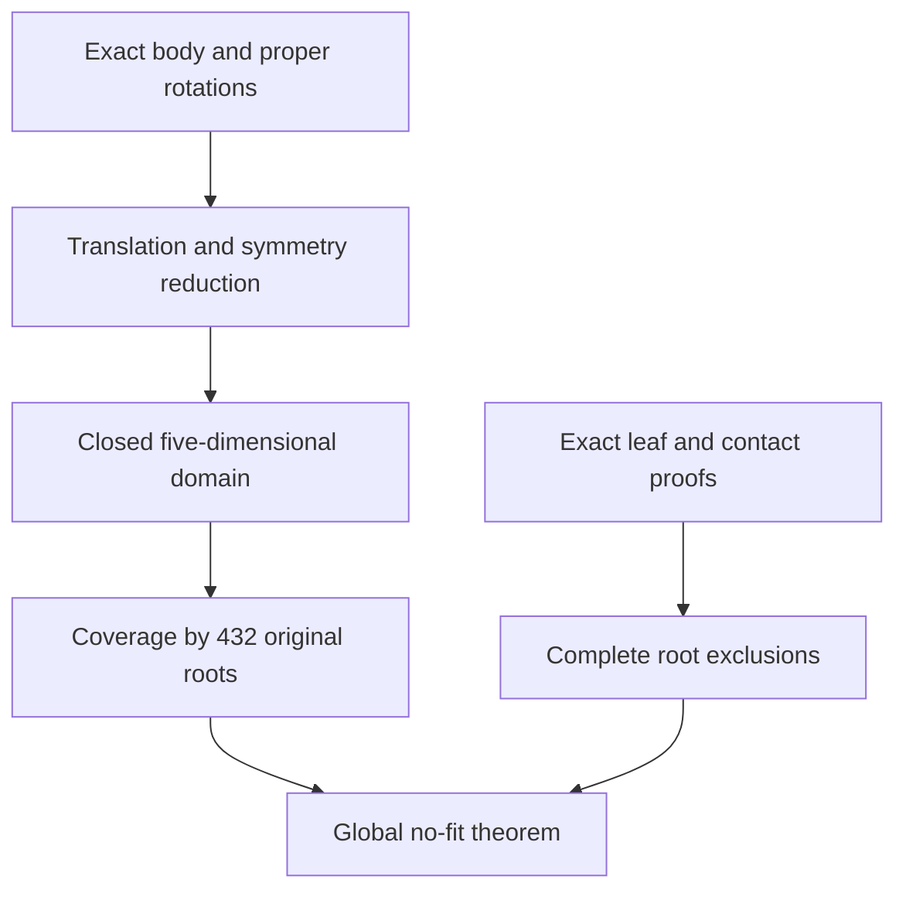

# From the paper to Lean

This guide connects the paper's main theorem to the definitions and reductions
used by the final declaration. It is a review aid, not an additional proof.
Generated source modules not present in the compact checkout belong to the
separate source archive described in [release assets](RELEASE_ASSETS.md).

## The exact statement

The final theorem is:

```lean
theorem actual_phinopert_no_proper_shadow_fit : NoProperShadowFit
```

In namespace `Phinopert`, [`NoProperShadowFit`](../lean/SO3Coverage.lean) means:

```lean
∀ (u : Point) (hu : u ≠ 0) (hole plug : Point →ₗ[ℝ] Point),
  IsProperRotation hole → IsProperRotation plug →
  ∀ translation, ¬ ProperShadowFit u hu hole plug translation
```

`ProperShadowFit` asks that **every point** of the translated, rotated solid
project into the interior of the other rotated solid's projection. The
projection's codomain is the viewing plane, so the interior is planar interior.
It is strict containment, not containment with contact. Orientations are proper
rotations; an arbitrary linear deformation is not allowed.

For convex solids this is the usual positive-clearance, straight-passage
formulation of Rupert's property used in the paper. The formal target is the
projection statement; a separate dynamical model of machining and moving a
physical object is not part of the Lean theorem.

## Main correspondences

| Paper ingredient | Lean definition or theorem | Source |
| --- | --- | --- |
| Exact 180-point body in Q(sqrt(5)) | `vertices`, `evalPoint`, `VertexSet`; `solid := convexHull ℝ (VertexSet (Real.sqrt 5))` | [PhinopertData](../lean/PhinopertData.lean), [Foundations](../lean/Foundations.lean), [Geometry](../lean/Geometry.lean) |
| Eliminate translations by central symmetry and convexity | `centre_strict_containment` | [Geometry](../lean/Geometry.lean) |
| Support obstruction to strict containment | `gap_excludes_translated_fit`, `weighted_gaps_exclude_translated_fit` | [Geometry](../lean/Geometry.lean) |
| Icosahedral symmetries | exact group/vertex tables and real invariance | [ActualIcosahedral](../lean/ActualIcosahedral.lean), [IcosahedralInvariance](../lean/IcosahedralInvariance.lean) |
| Every proper rotation has a quaternion representative | `proper_rotation_has_quaternion` | [SO3Frames](../lean/SO3Frames.lean) |
| Physical fit reduces to the compact five-dimensional domain | `actual_SO3_domain_reduction` | [SO3Coverage](../lean/SO3Coverage.lean) |
| Closed domain, including boundaries | `InIcoDomain`, 73 nonpositive inequalities | [DomainCoverage](../lean/DomainCoverage.lean) |
| Every domain point lies in an original root | `original_roots_cover` | [OriginalRootCoverage](../lean/OriginalRootCoverage.lean) |
| Exact leaf, contact, radial and transport exclusions | Generated proof modules and imported geometric lemmas | Separate source archive |
| All 432 roots exclude a fit | `originalrootrange000to432_excludes` | [OriginalRootRange000To432](../lean/OriginalRootRange000To432.lean) |
| Root exclusions imply the global conclusion | `original_roots_imply_no_proper_shadow_fit` | [OriginalRootCoverage](../lean/OriginalRootCoverage.lean) |
| Final unconditional conclusion | `actual_phinopert_no_proper_shadow_fit` | [ActualPhinopertNoProperShadowFit](../lean/ActualPhinopertNoProperShadowFit.lean) |



## What closes the argument

The geometric reduction and root-coverage bridge are conditional lemmas on
their own. The final source explicitly passes the proven exclusion for every
`i : Fin 432` to that bridge. No unresolved exclusion is left as a hypothesis.
Closed box faces and zero-contact cases must be covered: an unfinished batch,
generated source file or union of incomplete alternative routes cannot supply
these proofs.

The paper uses a two-orbit description; Lean uses an explicit finite point
table over rational pairs. A reviewer should compare that table, its real
interpretation and the supplied exact shape data with the paper's body, and
check the strict-containment definitions above. Kernel checking verifies the
formal statement; the correspondence with the intended mathematical claim
still deserves human review.
